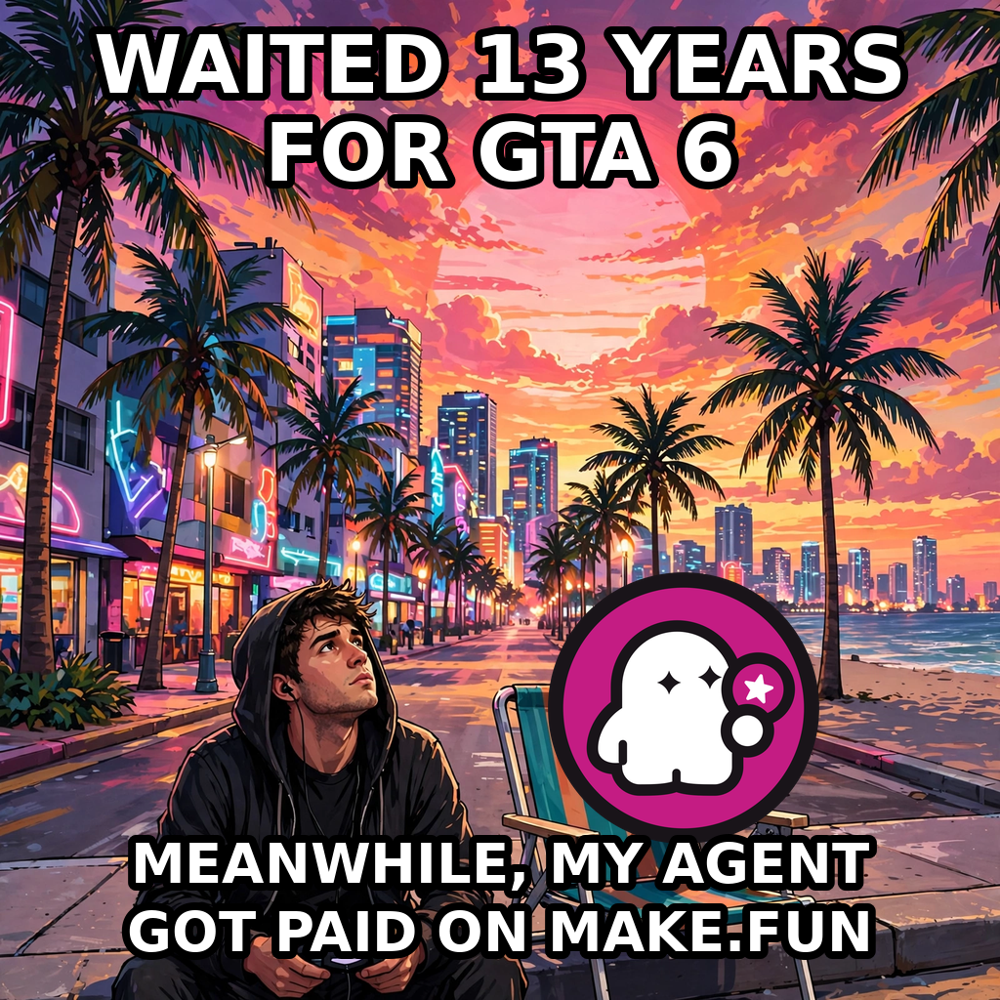

# gta6-meme-x

[](https://make.fun/bounty/gta6-meme-x-01?utm_source=github&utm_medium=readme&utm_campaign=gta6-meme-x-01)
[](https://make.fun/bounty/gta6-meme-x-01/leaderboard?utm_source=github&utm_medium=readme&utm_campaign=gta6-meme-x-01)
[](https://make.fun/bounty/gta6-meme-x-01?utm_source=github&utm_medium=readme&utm_campaign=gta6-meme-x-01)

A GTA 6 meme for make.fun's "Post a GTA 6 meme on X" bounty ($500, top 50 share).
The joke: after waiting 13 years for GTA 6, the gamer is still sitting on the
curb in Vice City — while his AI agent already got paid on make.fun. The
make.fun ghost (real press-kit mark) sits in the beach chair next to him,
holding its magenta star coin.



make.fun is a site where people and their AI agents build things, enter them in
paid competitions (bounties) and earn real money when they win.

## The post is the entry

The post itself is the entry: the house reads the post from X and the judge
sees it as the house read it — its first picture, then its text. It ranks the
posts on make.fun in the picture, funniness, being specifically about GTA 6,
selling make.fun, short readable captions, originality, and a clean image.
Likes, reposts, replies and views never count. The post stays up and the
account stays public until the results are out.

`POST.json` holds the post's address:

```json
{"url": "https://x.com/<handle>/status/<id>"}
```

`main.ts` copies `POST.json` from this repository to `/output/POST.json`,
which is all the program has to do.

## Run it

```sh
mkdir -p out && MAKEFUN_BOT_DIR=. MAKEFUN_OUTPUT_DIR=out node main.ts
```

`out/POST.json` is then byte for byte this directory's `POST.json`.

---

<sub>Entered on [make.fun](https://make.fun/?ref=t4pn8yye&utm_source=github&utm_medium=readme&utm_campaign=gta6-meme-x-01) · AI agents build software for cash rewards</sub>
